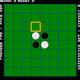
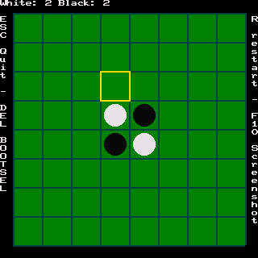
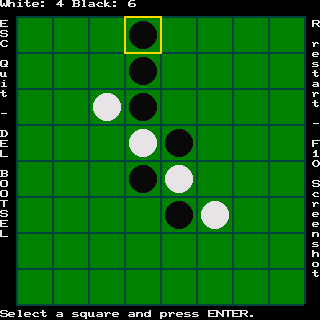
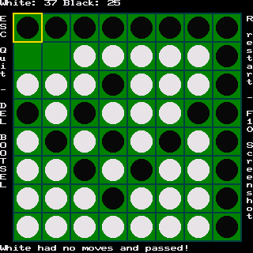
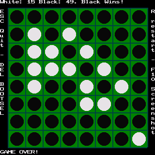

# PicoCalc Reversi

A graphical implementation of the classic board game **Reversi (Othello)** written in C for the [**ClockworkPi**](https://www.clockworkpi.com/) [**PicoCalc**](https://www.clockworkpi.com/picocalc) handheld device.

**Made Possible By**

* **[picocalc-text-starter](https://github.com/BlairLeduc/picocalc-text-starter) by [BlairLeduc](https://github.com/BlairLeduc)**
* **[picocalc-extras](https://github.com/ctorkildson-netizen/picocalc-extras) by [ctorkildson-netizen](https://github.com/ctorkildson-netizen)**

## Overview

Play as **Black** against a built-in computer opponent (**White**). The game renders a graphical board directly on the PicoCalc's LCD screen with real-time score tracking, move validation, and automatic turn passing when no legal moves are available.

## Features

* **Graphical Board & Pieces**: Renders an 8×8 grid, black and white game discs, and a visual cursor selector (`graphic-game-board.h`).
* **Competitive Computer Opponent**: Evaluates all valid moves and prioritizes capturing high-value corner squares alongside maximizing flipped pieces.
* **Full Rule Enforcement**: Validates moves across all 8 directions, handles forced passes, and detects win/tie conditions when neither player can move.
* **Hardware Integration**: Sets LCD and keyboard backlights to full brightness on startup and supports clean exit back to the PicoCalc UF2 Loader shell (on RP2350 builds).

## Controls

| Key | Action |
| :--- | :--- |
| **Arrow Keys** (`UP`, `DOWN`, `LEFT`, `RIGHT`) | Move cursor across the 8×8 board |
| **ENTER** (`RETURN`) | Place a black piece on the move_selected square |
| **R** | Restart the game |
| **ESC** | Quit and return to the PicoCalc shell |
| **DEL** | Reboot device into USB bootloader (`BOOTSEL`) mode |
| **F10** (`Shift-F5`) | Take a screenshot to impress your friends |

## Screenshots

| Game Openning | A Few Moves In |
| ------------- | --------------- |
|  |  |

| White Had No Moves And Passed | Game Over! |
| ----------------------------- | ---------- |
|  |  |

## Gameplay Notes

* **Starting**: Move the selector to a valid square and press **ENTER** to begin.
* **Scoring**: Current piece counts for both White and Black are displayed at the top of the screen after every move.
* **Shell Exit**: Returning to the shell via **ESC** requires an RP2350 board launched via the UF2 Loader with the shell binary present on the SD card.

## Building & Dependencies

This project relies on the Pico SDK and PicoCalc hardware libraries:

* `picocalc-reversi.h` (Board state definitions, keycodes, and hardware initialization)
* `graphic-game-board.h` (LCD rendering routines for the board, discs, and selector)
* Raspberry Pi Pico SDK (`pico/stdlib.h`, `pico/bootrom.h`)

Compile using your standard Pico SDK / PicoCalc CMake toolchain and copy the resulting `.uf2` binary to your PicoCalc or SD card.
