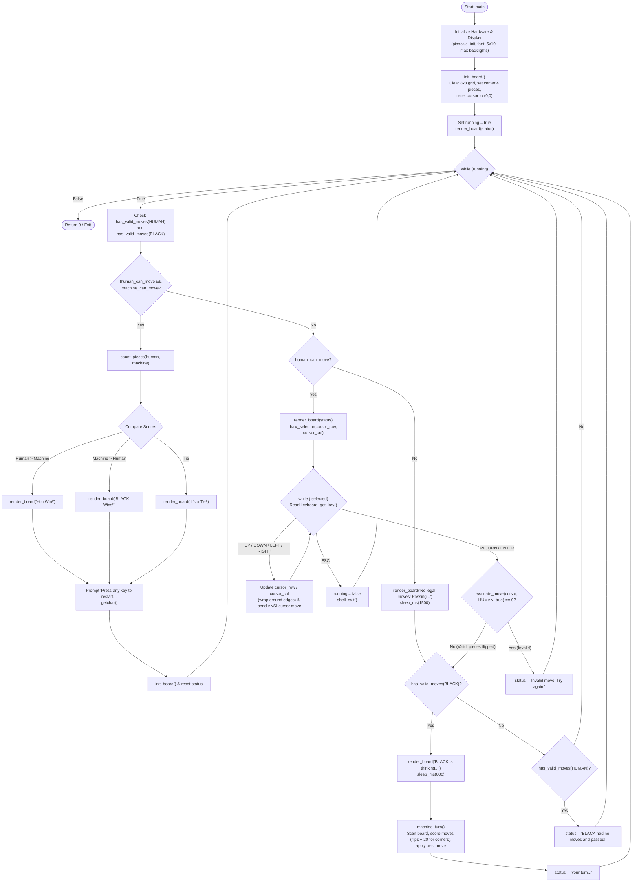

# PicoCalc Reversi

A terminal-based implementation of the classic strategy board game **Reversi (Othello)** written in C for the **PicoCalc** handheld device (Raspberry Pi Pico / RP2040 & RP2350).

## Credits

This project is made possible by the [picocalc-text-starter](https://github.com/BlairLeduc/picocalc-text-starter) project by [BlairLeduc](https://github.com/BlairLeduc).  Check out it for more details.  The contents of the `docs` and `drivers` folders are from that work.

## Features

* **Interactive Grid Navigation**: Smooth cursor movement across an 8×8 board with automatic edge wrap-around.
* **ANSI & DEC Box-Drawing UI**: Clean, color-coded terminal grid (`H` in red for Human, `M` in blue for Machine) with live score tracking and status prompts.
* **Heuristic AI Opponent**: Built-in computer opponent that evaluates all legal moves, maximizes piece flips, and prioritizes high-value corner positions (`+20` weight bonus).
* **Full Reversi Ruleset**: Validates moves across all 8 directions, automatically passes turns when no legal moves are available, detects endgame conditions, and supports instant game restarts.
* **PicoCalc Shell Integration**: Cleanly exits back to the RP2350 SD card shell via `ESC` when launched through the UF2 Loader.

## Controls

| Key | Action |
| :--- | :--- |
| **Up / Down / Left / Right** | Move cursor across the 8×8 board (wraps around edges) |
| **Enter / Return** | Place piece (`H`) at the selected square |
| **ESC** | Exit the game and return to the PicoCalc shell |
| **Any Key** *(at Game Over)* | Restart a new match |

## How to Play

1. The game starts with four pieces placed in the center of the 8×8 grid (`D4`, `E5` for Machine; `D5`, `E4` for Human).
2. You play as **Human (`H`)** and move first. Use the arrow keys to navigate to an empty square that brackets at least one horizontal, vertical, or diagonal line of **Machine (`M`)** pieces between your new piece and an existing `H` piece.
3. Press **Enter** to place your piece and flip all bracketed opponent pieces.
4. If a player has no legal moves, their turn is automatically passed.
5. The game ends when neither player can make a valid move. The player with the most pieces on the board wins.

## Building & Installation

### Prerequisites

* [Raspberry Pi Pico SDK](https://github.com)
* CMake (`>= 3.13`) and ARM GCC toolchain (`arm-none-eabi-gcc`)
* PicoCalc hardware drivers (`drivers/display.h`, `drivers/keyboard.h`, `drivers/lcd.h`, `drivers/picocalc.h`, etc.) and `picocalc-reversi.h`

### Build Steps

1. Clone this repository into your `foo` project directory alongside your PicoCalc driver libraries:

   ```bash
   git clone <your-repo-url> foo
   cd foo
   ```

2. Create a build directory and compile with CMake (set `PICO_BOARD` according to your hardware, e.g., `pico` or `pico2`):

   ```bash
   mkdir build && cd build
   cmake -DPICO_BOARD=pico2 ..
   make -j4
   ```

3. Copy the resulting `.uf2` binary to your PicoCalc's SD card for use with the **UF2 Loader**, or flash it directly over USB in BOOTSEL mode.

## Project Structure

```text
/picocalc-reversi
├── CMakeLists.txt
├── docs
├── drivers
├── pico_sdk_import.cmake
├── picocalc-reversi.c
├── picocalc-reversi.h
├── README.md
└── third_party
```

## License

Attribution-NonCommercial-ShareAlike 4.0 International

See: [License]

## A Simplified Flowchart



![A simplified flowchart of the PicoCalc Reversi program. The primary subject is a tall, vertically organized process diagram tracing initialization, repeated turn checks, human keyboard input and cursor movement, move validation, the machine AI turn, pass states, game-over scoring, and restart or shell exit. A neutral technical tone is conveyed with rounded boxes, rectangles, diamonds, and directional arrows on a light background. Transcribed text includes main Start; picocalc_init, init_board & lcd_set_font; render_board: Initial board & instructions; while running?; Check human_can_move & machine_can_move; Both False?; count_pieces & render_board Winner/Tie; Wait for getchar & call init_board; human_can_move?; render_board 'Passing...' & sleep 1500ms; render_board & draw_selector; while !selected; keyboard_get_key; Arrow Keys; KEY_RETURN; KEY_ESC; running = false & shell_exit; evaluate_move apply=true == 0?; Set status 'Invalid move. Try again:'; has_valid_moves BLACK?; render_board 'Thinking...', sleep 600ms & machine_turn; Set status 'Your turn...'; has_valid_moves HUMAN?; and Set status 'BLACK had no moves and passed!' Labels also indicate True, False, Yes, and No at decision branches.](flowchart.svg)
